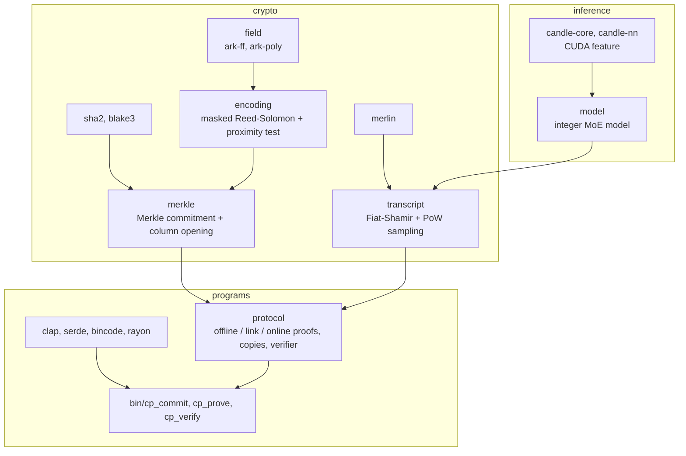

# FlashProve — Rust Implementation Plan

Reimplementation of the three executable programs (`cp_commit`, `cp_prove`,
`cp_verify`) from *FlashProve: Hash-Based Proofs of LLM Inference at 400
Billion Parameters*. The Lean 4 formalization is a separate effort and is out
of scope here.

## 1. Dependency graph

Modules and their external dependencies. Arrows read "depends on".



External dependency → purpose table:

| Crate | Used in | Purpose |
|---|---|---|
| `ark-ff` | `field` | 64-bit prime field (`Fp64`), `PrimeField` trait |
| `ark-poly` | `encoding` | univariate polynomials + FFT for RS encode/decode |
| `sha2` | `merkle`, `transcript` | random oracle (SHA-256) |
| `blake3` | `merkle` | fast Merkle-leaf / PoW hashing |
| `rs_merkle` | `merkle` | Merkle proof primitives |
| `merlin` | `transcript` | Fiat-Shamir transcript |
| `candle-core` / `candle-nn` | `model` | tensor + GPU execution of the integer MoE model |
| `rand_chacha` | `transcript`, `model` | deterministic seeded randomness (masks, copies) |
| `serde` + `bincode` | `bin/*` | proof-file and config serialization |
| `serde_json` | `bin/*` | human-readable config files |
| `clap` | `bin/*` | subcommands |
| `rayon` | `bin/*`, `merkle` | data-parallel batches / leaf hashing |
| `zeroize` | `model`, `field` | zeroize weights and masks |
| `anyhow` / `thiserror` | all | errors |
| `tracing` + `tracing-subscriber` | all | logging |
| `criterion` / `proptest` | dev | benchmarks / property tests |

Note: `reed-solomon-erasure` is **not** used — it targets GF(2^8), while the
protocol requires Reed–Solomon over the 64-bit prime field.

## 2. Project layout

```
flash-prove/
  Cargo.toml            # single package "flashprove"
  src/
    lib.rs              # pub mod field, encoding, merkle, transcript, model, protocol
    field.rs
    encoding.rs
    merkle.rs
    transcript.rs
    model.rs
    protocol.rs
    bin/
      cp_commit.rs
      cp_prove.rs
      cp_verify.rs
```

## 3. Module responsibilities

### `field`
- Re-export `ark-ff::Fp64`; define the concrete 64-bit prime.
- Digit representation of weights (`matrix of digits`, Definition 3.1).
- Montgomery / `mulmod` helpers; constant-time comparison via `subtle`.
- Zeroization of secret field elements.

### `encoding`
- Masked Reed–Solomon row encoding: encode each row with `t` random lowest
  coefficients (Definition 4.2).
- Proximity test running **below the Johnson radius** (list decoding to a
  codeword up to small error).
- Out-of-domain masked linear forms (Definition 4.5).
- Depends on: `field`, `ark-poly`.

### `merkle`
- Merkle tree over the encoded table (single streaming pass).
- Column opening proofs + the `t`-column opening budget accounting
  (Definition 4.2 / Proposition 6.5).
- The 32-byte commitment: hash of 3 config files + first-table root +
  out-of-domain answers + seed.
- Depends on: `encoding`, `sha2`, `rs_merkle`.

### `transcript`
- Fiat–Shamir transcript over `merlin`.
- Proof-of-work position-sampling rounds (Construction 4.13).
- Depends on: `field`, `merlin`, `rand_chacha`.

### `model`
- Integer MoE model shaped like Llama 4 Maverick (Definition 3.1).
- **Custom arithmetic-sensitive ops** (digit dequant + integer matmul) — must
  match the paper bit-for-bit; `candle` is used for tensor plumbing and GPU
  execution, not for the quantized matmul kernels.
- Exact-match greedy decoding; clipped-gap policy (Definition 3.4).
- Depends on: `field`, `candle-core`, `candle-nn`.

### `protocol`
- The three IOPs: offline (decodes to in-range matrix), link (copy decodes to
  same matrix), online (output meets policy).
- Copies with fresh randomness; compilation of IOPs into the verifier `V_Z`.
- `Chk(Z)` / admissible-configuration validation (Definition 3.8, 6.11).
- Depends on: `merkle`, `transcript`, `model`.

### `bin/` (`cp_commit`, `cp_prove`, `cp_verify`)
- The three executable programs.
- Config-file parser (three byte-string files) and proof-file I/O.
- Batch-of-24 serving pipeline; one-copy-opened-once-per-batch.
- Depends on: `protocol`, `clap`, `serde`, `bincode`, `rayon`.

## 4. Milestones (ordered)

1. **Field layer** — `Fp64`, prime, digit representation. Foundation for
   everything.
2. **Masked Reed–Solomon encoding + proximity test** — row encode/decode,
   Johnson-radius list decoding. Depends on (1).
3. **Merkle commitment + column opening + budget** — streaming tree, column
   openings, `t` budget. Depends on (2).
4. **Fiat–Shamir transcript + PoW sampling** — `merlin` transcript, PoW rounds.
   Depends on (1).
5. **Integer MoE model on candle** — exact-match integer arithmetic, greedy
   decode, clipped-gap policy. Depends on (1). (CPU-first, CUDA later.)
6. **Protocol: IOPs + verifier** — offline/link/online proofs, copies,
   compilation. Depends on (3), (4), (5).
7. **Programs** — `cp_commit`/`cp_prove`/`cp_verify`, config parsing, batching.
   Depends on (6).

## 5. Key risks

- **Exact-match integer arithmetic** — `candle`'s default q4k kernels will not
  reproduce the paper's integer model bit-for-bit; the arithmetic-sensitive
  ops are custom.
- **RS over a 64-bit prime field** — no off-the-shelf crate; correctness of the
  below-Johnson-radius proximity test is the hardest crypto component.
- **Opening budget** — `t` columns per committed table; must be enforced and
  counted, or weight-leakage results.
- **GPU path** — start CPU-only for correctness, add `candle` CUDA after the
  verifier accepts honest proofs end-to-end.
